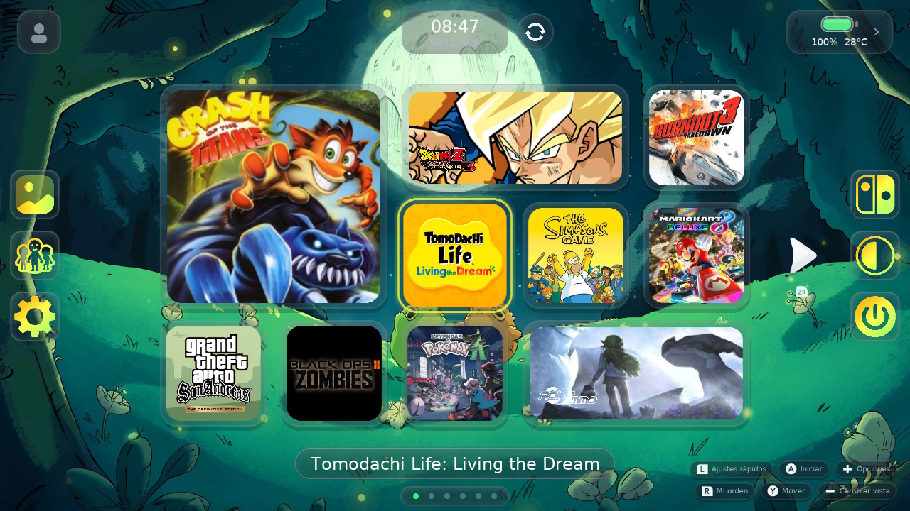
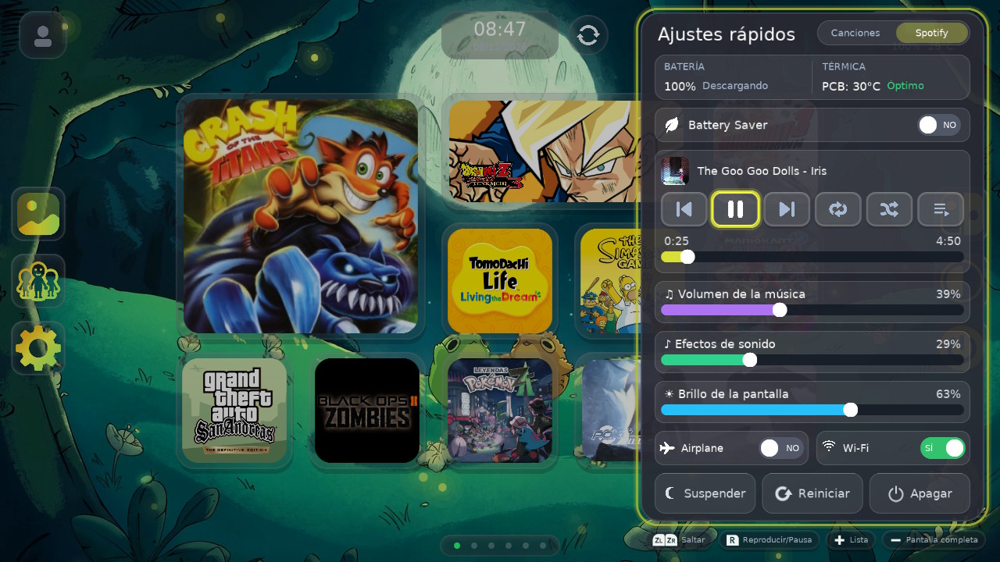
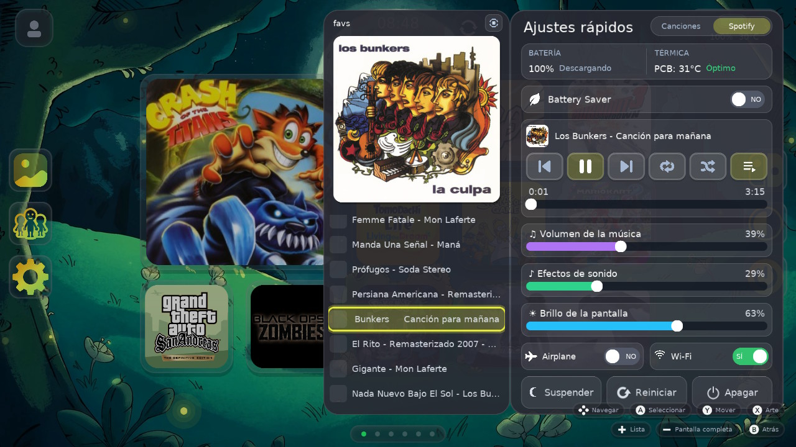
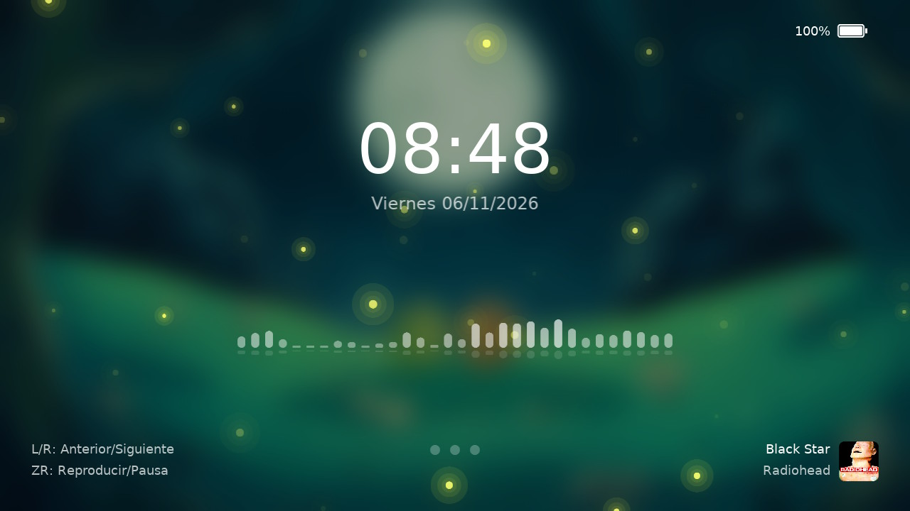

<!-- Bloque compartido: es el mismo en cristowo/SwitchU y cristowo/Switify. -->
# SwitchU + Switify (fork de cristowo)

Dos forks que funcionan juntos en la Switch:

| Repositorio | Fork de | Rama | Qué es |
| --- | --- | --- | --- |
| [cristowo/SwitchU](https://github.com/cristowo/SwitchU) | [PoloNX/SwitchU](https://github.com/PoloNX/SwitchU) | `switify-integration` | Menú HOME estilo Wii U, con Spotify integrado |
| [cristowo/Switify](https://github.com/cristowo/Switify) | [DomazinUS/Switify](https://github.com/DomazinUS/Switify) | `switchu` | Servicio en segundo plano de Switify, ajustado para SwitchU |

## Capturas

| HOME | Spotify en los Ajustes rápidos |
| --- | --- |
|  |  |
| **Una playlist de Spotify** | **Pantalla de bloqueo con Spotify** |
|  |  |

## Créditos

- **SwitchU**: [PoloNX](https://github.com/PoloNX) y sus colaboradores (GPL-3.0).
  [uLaunch](https://github.com/Xortroll/uLaunch), de [Xortroll](https://github.com/Xortroll),
  inspiró el proyecto.
- **HomeNX**: la pantalla de bloqueo y su contraseña, el zoom al salir de un juego,
  la subida de texturas sin bloqueo, los nombres de juego personalizados, el ajuste
  de efectos de cristal y la temperatura del chip vienen de
  [HomeNX](https://github.com/ad3333m/homenx), de ad3333m (GPL-3.0). Su pantalla de
  bloqueo es de PowerCmptr.
- **Switify**: HiroshiYamauchi ([DomazinUS/Switify](https://github.com/DomazinUS/Switify)).
  La app es GPL-3.0-or-later y el overlay GPL-2.0-only. Usa
  [cspot](https://github.com/feelfreelinux/cspot) y bell, de feelfreelinux y
  colaboradores; el resto de dependencias está en `THIRD_PARTY_NOTICES.md` de Switify.
- **Cambios de estos forks**: cristowo, desarrollados con Claude Code (Anthropic).

Todo el trabajo original pertenece a sus autores. Estos forks mantienen sus licencias.

## Qué cambia respecto a los originales

### SwitchU

- **Música unificada**: selector Canciones / Spotify en los Ajustes rápidos (L).
  Spotify se controla y se explora (cola, playlist, biblioteca, inicio, búsqueda)
  a través del servicio de Switify. Suena una sola fuente a la vez.
- **Widgets de música**: "Reproduciendo" en 1x1 (la portada ocupa todo el
  recuadro, con las barras encima), 2x1 y 2x2 (portada, canción, barras y
  progreso). Además, "Playlists de Spotify": muestra una playlist de tu
  biblioteca; con Más pasas a la siguiente o la anterior, y con A suena ahí
  mismo, sin abrir los Ajustes rápidos.
- **Pantalla de bloqueo** al despertar, con contraseña opcional, controles de música
  y barras de espectro. Muestra "Reconectando..." mientras Spotify vuelve.
- **Al encender la consola** suena la música del tema desde su canción de HOME
  ("Wii U Home Menu"), aunque lo último haya sido Spotify.
- **Sin suspensión automática con música** (Ajustes, Suspensión; activada por
  defecto): mientras suena música en HOME o en la pantalla de bloqueo, la consola
  no se suspende sola.
- **Cerrar juego**: pide confirmación y cierra al instante, como el HOME original.
  Antes esperaba hasta 15 s a un juego suspendido.
- **Fiabilidad**:
  - el menú elige su memoria según lo que queda libre;
  - se reconecta a la SD si el sistema le corta la sesión;
  - manda su log en vivo al daemon durante el arranque, así un fallo al iniciar queda registrado;
  - los logs viejos del daemon se borran por fecha.

### Switify (solo el servicio en segundo plano)

El detalle está en `SWITCHU-CHANGES.md` de Switify. En resumen:

- **`GetAudioLevels` (comando 38)**: 32 bandas del audio que suena, para las barras
  de SwitchU. Solo se calculan si alguien las pide.
- **`ReloadCurrent` (comando 39)**: tras suspender la consola, espera a que vuelva la
  sesión de Spotify y retoma la misma canción donde iba, en vez de saltarla.
- **Lo cargado sigue sonando al reconectar**: siempre hay unos 5 s de canción
  descargados por adelantado (10 s en calidad normal). Al despertar suena eso y,
  cuando vuelve la conexión, el mismo stream sigue desde el byte donde quedó: sin
  saltos y, si vuelve a tiempo, sin cortes. Si no puede, la canción se recarga en
  la posición exacta del decodificador. El estado lleva el flag
  `SwitifyStatusFlag_Reloading` (bit 8) mientras tanto.
- **Conexión al CDN más robusta**: una respuesta que no sea el rango pedido cierra
  la conexión y abre otra, en vez de arruinar las siguientes y cambiar de canción.
- **Memoria a demanda**: el heap ya no es un bloque fijo de 4 MiB. Se toma en pasos
  de 2 MiB según se necesita, hasta el mismo máximo. El servicio cuenta contra la
  memoria del sistema, y con 4 MiB fijos abrir HOME sobre un juego podía agotarla:
  el menú se quedaba en negro.
- **Cuenta como applet** (`application_type: 2` en `switify-sysmodule.json`): su
  memoria sale del espacio de los applets, junto al menú y el daemon de SwitchU,
  que tiene decenas de MiB libres, y no de la memoria del sistema.
- **Errores del CDN**: un hueco en el audio ya no cambia de canción, y una página de
  error del CDN ya no se decodifica como audio.

## Cómo dependen uno del otro

- **SwitchU funciona sin Switify**, pero solo con su música propia. Para Spotify hace
  falta el servicio de Switify en
  `sdmc:/atmosphere/contents/4200000000535754/exefs.nsp`. También hay que haber
  iniciado sesión una vez con la app de Switify (NRO), porque el servicio reutiliza
  esas credenciales en `sdmc:/config/Switify/`.
- **Con el servicio oficial de Switify** Spotify también funciona, pero:
  - no hay barras de espectro;
  - tras suspender, la canción puede saltar o quedarse en silencio;
  - el heap fijo de 4 MiB puede dejar el sistema sin memoria al abrir HOME sobre un juego.
- **Este fork de Switify solo reemplaza el servicio en segundo plano**. El overlay
  y la app NRO oficiales siguen sirviendo tal cual: el servicio les responde igual
  y ellos ignoran los comandos y el flag nuevos.
- **El protocolo IPC está definido en dos sitios que deben coincidir**:
  `phase2/common/include/switify/ipc_protocol.h` en Switify y
  `projects/menu/src/core/SwitifyProtocol.hpp` en SwitchU. Un comando nuevo se añade
  en ambos.

### Compilar e instalar

- **SwitchU**: con xmake y devkitPro (ver "How to build" más abajo). `xmake install -o sd_out`
  deja en `sd_out/` la estructura de la SD.
- **Servicio de Switify**: con devkitA64 r30 (GCC 16), como el oficial. Desde la raíz de Switify:

  ```
  cmake -S phase2/sysmodule -B phase2/build_engine -G Ninja -DCMAKE_TOOLCHAIN_FILE=/opt/devkitpro/cmake/Switch.cmake -DCMAKE_BUILD_TYPE=Release
  ninja -C phase2/build_engine switify-background-package
  ```

  Copia `phase2/build_engine/switify-background.nsp` como
  `sdmc:/atmosphere/contents/4200000000535754/exefs.nsp`.
- **Reinicia la consola** después de cambiar el daemon de SwitchU o el servicio de Switify.

---

<!-- Fin del bloque compartido. Abajo sigue el README original del proyecto. -->

<div align="center">
    <h1>SwitchU</h1>
    <p>A Wii U-style custom home menu replacement for Nintendo Switch</p>
</div>

<p align="center">
  <a rel="LICENSE" href="https://github.com/PoloNX/SwitchU/blob/master/LICENSE">
    
  </a>
  <a rel="VERSION" href="https://github.com/PoloNX/SwitchU/releases">
    
  </a>
  <a rel="BUILD" href="https://github.com/PoloNX/SwitchU/actions">
      
  </a>
</p>

---

- [Screenshots](#screenshots)
  [Installation](#installation)
- [How to build](#how-to-build)
- [SwitchU Manager](#switchu-manager)
- [Help me](#help-me)
- [Credits](#credits)
- [License](#license)


## Screenshots


<details>
  <summary><b>More screenshots</b></summary>


</details>

## Installation

Download ``SwitchU.zip`` [here](https://github.com/PoloNX/SwitchU/releases/latest) and extract ``atmosphere`` and ``switch`` folders at the root of your sdcard

## How to build

### Requirements

- [devkitPro](https://devkitpro.org/wiki/Getting_Started)
- [Xmake](https://xmake.io/#/)

### Clone

```bash
git clone --recursive https://github.com/PoloNX/SwitchU
cd SwitchU
```

### Build (production daemon + external menu mode)

```bash
xmake f -p cross --toolchain=devkita64 --homebrew=n --backend=deko3d
xmake
```

### Build (homebrew .nro mode)

```bash
xmake f -p cross --toolchain=devkita64 --homebrew=y --backend=deko3d
xmake
```

### Clean

```bash
xmake clean
```

Build outputs are generated under `build/cross/aarch64/<mode>/`.

## SwitchU Manager

`SwitchU-Manager.nro` enables or disables SwitchU

## Know issues
- Some settings are not implemented yet
- Current icons are very ugly, feel free to replace them with better ones
- You may experience some crash when using a lot of sysmodules. I tried to reduce the ram usage but I still get some instability when launching a game.

## Unsorted roadmap
- [x] Add a pannel when pressing + on a game to show more information about it    
- [x] Add controller/screen test window
- [x] Add Wii U-style folders
- [ ] Improve theme shop UI and metadata
- [ ] Add eshop and news applet  
- [x] Add a setting to switch the theme based on the time of day  
- [x] Add a steamgriddb integration to get game banners and backgrounds  
- [ ] Replace temporary icons with polished assets
- [x] Add more animations inspired by Wii U
- [x] Improve localization coverage

## Help me

If you want to help, open an issue when you find a bug and open a pull request if you have a fix.

## Credits

- Thanks to [Xortroll](https://github.com/Xortroll) for the help and for [uLaunch](https://github.com/Xortroll/uLaunch) which inspired this project a lot
- Lock screen look and password, the zoom out of a game, non-blocking texture uploads, custom game names, the glass effects switch and the chip temperature reading come from [HomeNX](https://github.com/ad3333m/homenx) by ad3333m (GPL-3.0); its lock screen is by PowerCmptr

## License

This project is licensed under the GNU General Public License v3.0. See the [LICENSE](https://github.com/PoloNX/SwitchU/blob/master/LICENSE) file for details.
